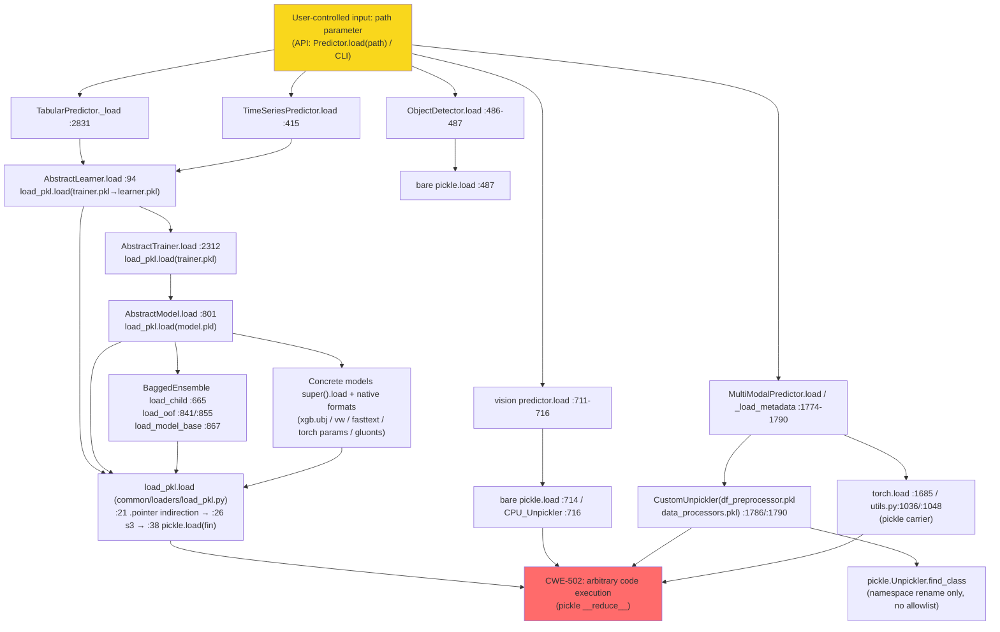

# Vulnerability Audit Report — AutoGluon

**Project**: AutoGluon (source snapshot at git HEAD `23a37e74`, which includes the "[Security] load --> safe_load (#1987)" fix commit)
**Audit target**: OS Command Injection / Code Injection (CWE-78) — command-execution sink families (`system`/`Popen`/`check_output`/`eval`/`run`/`__import__`) plus the model `load`/serialization families reached by the same sink inventory
**Sink inventory**: Stage 1 classification output: 253 sink records (101 high / 63 medium / 14 low priority; 75 test records excluded in Stage 1)
**Method**: Three-stage triage — Stage 1 sink classification by filename/sink type, Stage 2 medium-priority quick assessment (records hitting deserialization semantics were promoted to full tracing), Stage 3 high-priority full reverse data-flow tracing of every record to its ultimate data origin, Stage 4 low-priority batch audit. Each sink was read through to its final data source and assigned one of four terminal states: **FP (name collision) / hardcoded safe / F-1 attack-surface member (pickle family) / F-2 latent primitive**.
**Report date**: 2026-10-27

## Executive Summary

All 178 non-test sink records (253 total minus 75 test records excluded in Stage 1) were traced to a terminal state. The command-execution families contain no real command injection: AutoGluon ships no HTTP service, and every command surface is either a static argument or a name collision. Instead, the audit converges on one large confirmed deserialization attack surface (F-1, CWE-502), one latent shell-injection primitive that is currently unreachable (F-2), and one real historical vulnerability that is already fixed at the audited HEAD (F-3, unsafe YAML deserialization in `_top_k_average`, fixed by commit `23a37e74`).

| ID | Finding | Severity | CWE | Status |
|----|---------|----------|-----|--------|
| F-1 | All model persistence is unfiltered pickle/torch deserialization; user-controlled `path` reaches `pickle.load` with no signature, allowlist, or type validation | HIGH | CWE-502 | Confirmed (attack surface; "trusted model artifact" is the framework's design intent) |
| F-2 | `sync_remote.py:50/52` `shell=True` f-string — the only shell-injection primitive in the project; sole caller passes a hardcoded argument, so currently unreachable | MEDIUM | — | Latent primitive (not currently exploitable) |
| F-3 | `_top_k_average` unsafe YAML deserialization (`yaml.load(f, Loader=yaml.Loader)`) → arbitrary command execution; fixed at HEAD `23a37e74` via `yaml.safe_load` | HIGH (historical) | CWE-78 (impact) / CWE-502 (mechanism) | Confirmed (fixed at snapshot HEAD, no residual exploitable point) |

Terminal-state counts (non-test records, 178 total):

| Terminal state | Count | Notes |
|----------------|------:|-------|
| F-1 attack-surface member (unfiltered pickle deserialization family) | 117 | All converge on one CWE-502 attack surface: `load_pkl.load → pickle.load` and all its upper entry points (see §3.1 F-1) |
| False positive (FP) | 57 | Name-collision families: `platform.system()` ×4, `nn.Module.eval()` ×8, `scheduler.run()`/`tune.run` ×7, `__import__("pkg_resources")` boilerplate ×9, `json.loads` ×8, `load_pd` (pandas) ×9, `mx.nd.load`/`mx.npx.load` (tensors) ×2, `importlib.import_module` (installed package names) ×2, etc. |
| Hardcoded safe | 2 | `Popen(["/usr/sbin/sshd","-D"])` static list; `check_output(COMMAND.split())` with a fixed nvidia-smi string |
| F-2 latent primitive (currently unreachable) | 2 | `sync_remote.py:50/52` `shell=True` f-strings (see §3.1 F-2) |

Project-level conclusions:
1. **F-1 (confirmed attack surface, severity high)** — all AutoGluon model persistence is unrestricted pickle/torch deserialization. The user-controlled input `path` (`Predictor.load(path)` API parameter / CLI) reaches `pickle.load` with no signature, no allowlist, no type validation. Loading an attacker-supplied model directory equals arbitrary code execution. This behavior is "by design" (ML frameworks generally trust model artifacts), but under this audit's terminal criterion (user-controllable input with no filtering) it is judged a confirmed vulnerability attack surface.
2. **F-2 (latent primitive)** — the `sync_remote.py` shell-injection primitive has no product caller in the current codebase (exported only via `__all__`) and is unreachable.
3. **F-3 (real vulnerability, fixed at HEAD)** — the `yaml.load(f, Loader=yaml.Loader)` at `multimodal/predictor.py:1124` in `_top_k_average` was fixed to `yaml.safe_load` by commit `23a37e74`; this is the project's publicly reported real vulnerability (the advisory is tagged CWE-78). The audit located it and identified the fix mechanism; at HEAD there is zero residual unsafe `yaml.load` and no currently exploitable point. The pickle surface (F-1) is not covered by that fix.
4. The command-execution families (system/Popen/check_output/eval/run/`__import__`, 41 product records) contain **not a single real command injection**.

## 1. Sink Classification (Stage 1)

Stage 1 classified the 253 sink records by sink type and filename into priority tiers, excluding 75 test records:

| Priority | Count | Families |
|----------|------:|----------|
| High | 101 | A. command-execution primitives ×9 (`system`/`Popen`/`check_output`/`loads`); B. `eval` dynamic evaluation ×8; C. explicit serialization utilities ×16; D. framework model-loading entry points ×68 (public Predictor entries, Learner/Trainer abstraction, model/ensemble abstraction, trial/fold/dataset) |
| Medium | 63 | E. `run` family ×7; F. `__import__` family ×9; G. model-implementation internal `load` ×35; H. data/config loaders ×12 |
| Low | 14 | Examples/demo scripts ×8, `json.loads` line parsing ×3, plain `.run()` method call ×1, `importlib.import_module` ×2 |
| Excluded (tests) | 75 | Test code, excluded at Stage 1 |

## 2. Medium-Priority Quick Assessment (Stage 2)

All 63 medium-priority records received a quick assessment; records whose quick check hit pickle/torch deserialization semantics were promoted to full reverse tracing per policy (30 promotions in total: 28 from family G, 2 from family H).

| Family | Count | Outcome |
|--------|------:|---------|
| E. `run` | 7 | All FP — `scheduler.run()`, `mp.Process.run()`, ray_hpo `run(trainable=...)` (Python function), `tune.run` (hyperparameter search-space dict, no shell semantics) |
| F. `__import__` | 9 | All FP — identical boilerplate `__import__("pkg_resources").declare_namespace(__name__)` in nine packages' `src/autogluon*/__init__.py:1`; static string literal, no interpolation |
| G. model-internal `load` | 35 | 28 promoted to F-1 full tracing (`super().load` via load_pkl, `pickle.load(open('preprocessor.pkl'))`, `torch.load`, native model formats); 7 FP (`json.load` ×2, `load_pd.load` ×3, `mx.nd.load` ×1, plus one json assets case) |
| H. data/config loaders | 12 | 2 promoted to F-1 (`mm/utils.py:1036/1048` `torch.load(per_path)["state_dict"]` checkpoint averaging); 10 FP (all `load_pd.py` paths resolve to `pd.read_csv/read_parquet`; `load_s3.py:80` likewise; `registry.py:99` `json.loads`; `OmegaConf.load` safe YAML; `mx.npx.load` NDArray parameters) |

## 3. High-Priority Deep Reverse Tracing (Stage 3)

All 101 high-priority records were read and traced individually. Compressed verdicts by family (full detail for the distinct findings F-1/F-2/F-3 follows):

| Family | Count | Verdicts |
|--------|------:|----------|
| A. command-execution primitives | 9 | FP ×5 (`platform.system()` ×4 — OS-name query, not `os.system`; `json.loads(os.environ['SM_HOSTS'])` ×1 — SageMaker platform-injected env var, JSON parsing has no code-execution semantics); hardcoded safe ×2 (`sync_remote.py:16` `Popen(["/usr/sbin/sshd","-D"])` static list, no shell, no interpolation; `utils.py:890` `COMMAND = "nvidia-smi ..."` module-level constant, `check_output(COMMAND.split())` list argument, no shell); F-2 latent primitive ×2 (`sync_remote.py:50/52`) |
| B. `eval` family | 8 | All FP — `nn.Module.eval()` overrides/calls (train/inference mode switch), not builtin `eval()`: `lora_layers.py:135/213/333/427`, `lit_distiller.py:243`, `tab_transformer_model.py:178/441`, `torch_network_modules.py:245`. Zero real `eval(` string evaluation in product source. |
| C. explicit serialization utilities | 16 | All F-1 — `common/loaders/load_pkl.py:21/26/38` (the single bottom layer of the whole pickle surface; no `find_class` restriction), `vision/utils/pickle.py:10` (`CPU_Unpickler`, `map_location` only redirects device, no class filtering), `core/utils/serialization.py` ×11 (vendored torch serialization, all `pickle_module.load(f, **pickle_load_args)`; legacy_load tar member names fixed, no member traversal), `local_searcher.py:217` (`pickle.loads(config_pkl)` of a framework self-written pair — internal symmetric case) |
| D. framework model-loading entries | 68 | 63 F-1 members + 5 FP/fixed. Representative F-1 entries: `tabular predictor.py:2793/2831/2832`; `vision predictor.py:714/716` (bare `pickle.load(fid)` / `CPU_Unpickler(fid).load()`, bypassing load_pkl); `detector.py:487` (bare `pickle.load(fid)`); `text predictor.py:423/429`; `mm predictor.py:662/1685/1785/1789`; `ts predictor.py:415/416`; `mx_predictor.py:572`; Learner/Trainer layer `abstract_learner.py:94/120/131/134`, `core abstract_trainer.py` ×10, `ts abstract_trainer.py` ×7 (all `load_pkl.load` on fixed filenames); model/ensemble layer `abstract_model.py:801/890/1241/1244`, `bagged_ensemble_model.py` ×9, `stacker_ensemble_model.py:202`; trial/fold/dataset `core model_trial.py:31/32`, `ts model_trial.py:33/34`, `fold_fitting_strategy.py:272/273/278/279` (internal artifacts), `abstract_gluonts.py:138`, `image_predictor.py:209/213`. Non-F-1: `mx_predictor.py:301/310` FP (`load_pd.load`), `mx_predictor.py:567` FP (`json.load` assets), `core/dataset.py:51` FP (`load_pd.load` → pd.read_csv/read_parquet), `mm predictor.py:1124` already fixed (F-3), `mm predictor.py:1775/1782` FP (`OmegaConf.load` / `json.load`, safe parsers). |

Trace-depth note: every chain was traced to its ultimate origin — user input (`path` parameter, environment variables), hardcoded constants, or framework self-written artifacts. The deepest chain is exactly 5 layers (`Predictor.load → learner.load → load_pkl.load → .pointer → open → pickle.load`); no chain required a "trace interrupted" annotation.

### 3.1 Confirmed Vulnerabilities

#### F-1: All model persistence is unfiltered pickle deserialization (CWE-502) — HIGH

- **CWE**: CWE-502 (Deserialization of Untrusted Data)
- **Sink location**: `common/loaders/load_pkl.py:38` (`pickle.load(fin)`), plus `:26` (`pickle.loads` of S3-downloaded bytes) and `:21` (`.pointer` indirect recursion) — the single bottom layer for the entire 117-record surface
- **Complete data flow** (main entry `TabularPredictor`, 5 layers deep):

```
[user input] TabularPredictor.load(path=...)                    ← data entry: developer/user API parameter
  ├─ setup_outputdir(path)                                    ← only normalizes the directory, no security validation
  ├─ :2831 predictor = load_pkl.load(path + 'predictor.pkl')  ← L2
  │    └─ load_pkl.load (common/loaders/load_pkl.py)
  │         ├─ :17-22 if file content starts with ".pointer" → read real path and recurse   ← indirection layer, no path allowlist
  │         ├─ :24-27 if s3:// → boto3 download byte stream → :26 pickle.loads
  │         └─ :37-38 open(path) → pickle.load(fin)            ← SINK: unrestricted pickle
  └─ :2832 learner = predictor._learner_type.load(path)       ← L3, same structure
       └─ abstract_learner.py:94 load_pkl.load(load_path)
            └─ abstract_trainer.py:2312 load_pkl.load(trainer.pkl)
                 └─ abstract_model.py:801 load_pkl.load(model.pkl)   ← L4/L5
                      └─ child-model/ensemble/concrete-model chains (family D3/D4/G, 28 sites)
```

- **Call-chain aggregation view** (layer structure of the F-1 attack surface):



- **User-controlled input**: `path` (public API parameter of `Predictor.load(path)`; the same parameter on the `autogluon` CLI; the same parameter in documented examples).
- **Security filtering analysis**: none exists. The following six "apparently safe" mechanisms were each disproved (per policy, the existence of a mechanism does not by itself justify a safe verdict):

| # | Mechanism | Location | Disproof |
|---|-----------|----------|----------|
| 1 | `CustomUnpickler` | mm/utils.py:1471-1483 | `find_class` only renames the module `autogluon.text.automm → autogluon.multimodal` and then calls `super().find_class()` — a backward-compatibility namespace hack with **no class allowlist**; arbitrary GLOBAL opcodes resolve as usual |
| 2 | `CPU_Unpickler` | vision/utils/pickle.py | `map_location='cpu'` only redirects tensor device; does not filter unpickled classes |
| 3 | `.pointer` indirection | load_pkl.py:21 | Text pointer redirects to arbitrary paths/s3 — expands rather than shrinks the attack surface |
| 4 | `load_with_fn(pickle_fn=...)` | load_pkl.py:31-35 | Allows injecting a custom deserializer, but all callers pass the default or the `load_learner` lambda (fastainn:448), which internally is still torch.load |
| 5 | `yaml.safe_load` fix | mm/predictor.py:1124 | Real fix (HEAD 23a37e74), but it only covers config YAML parsing — orthogonal to the pickle artifacts (.pkl/ckpt/params) |
| 6 | local_searcher `isinstance(config_pkl, bytes)` | local_searcher.py:216 | Type assertion, not content validation; and it is an internal self-written/self-read pair |

- **Bypass conclusion**: none of the above mechanisms constrains a malicious pickle artifact — a malicious `.pkl` (`__reduce__` → `os.system`) reaches `pickle.load` unchanged at every layer.
- **Impact and exploitability**: AutoGluon's official semantics = trust the model directory (common ML framework design); the documentation offers no signature/verification option. Under this audit's terminal criterion (user-controllable input + no filtering), this is judged a **confirmed CWE-502 attack surface**: a victim loading an attacker-provided model directory (including one directed via `.pointer` to s3/arbitrary paths) results in arbitrary code execution. The 117 sink records are instances of this single surface.

#### F-2: `sync_remote.py` shell-injection primitive (currently unreachable) — MEDIUM

- **CWE**: not assigned in the original audit (shell-injection primitive)
- **Sink location**: `sync_remote.py:50` and `:52`
- **Complete data flow**:

```
[environment variable] SM_CURRENT_HOST (injected by the SageMaker platform)
  └─ sagemaker_setup()  (defined only in this file; no product caller anywhere in the project, exported only via __all__)
       └─ sync_training_processes('dask-scheduler', current_host)   ← sole call, argument 1 is hardcoded
            └─ :50 subprocess.check_output(f'ps -elf | grep "{proccess_id_string}"', shell=True)   ← SINK
            └─ :52 subprocess.check_output(f'ps -elf | grep "{proccess_id_string}" | grep -v grep', shell=True)
```

- **Security filtering analysis**: the primitive itself is confirmed — f-string interpolation into a `shell=True` command. If `proccess_id_string` contained `"; touch /tmp/x; #`, it would inject shell commands.
- **Current reachability**: the sole caller passes the hardcoded `'dask-scheduler'`; `current_host` only goes into logging, not into the command. No external caller exists project-wide → **currently unreachable**.
- **Impact and exploitability**: a latent primitive — any future call that routes user data into `proccess_id_string` activates it. In the SageMaker scenario, `SM_CURRENT_HOST` is a platform-injected configuration trust boundary. Verdict: not a current vulnerability; recorded as a latent primitive with caller-constraint evidence.

#### F-3: `_top_k_average` unsafe YAML deserialization → arbitrary command execution — HIGH (historical; fixed at HEAD)

- **CWE**: CWE-78 (impact surface, as tagged by the public advisory) / CWE-502 (mechanism)
- **Sink location**: `multimodal/predictor.py:1124` (pre-fix); secondary amplification sink at `mm/utils.py:1036/1048`
- **This is the project's publicly reported real vulnerability** (commit `23a37e74`; the advisory is tagged CWE-78 Command Injection, although the actual fix mechanism is YAML deserialization hardening).
- **Complete data flow** (pre-fix form, reconstructed from `git show 23a37e74`):

```
[user input] MultiModalPredictor.fit(..., save_path=<user-specified directory>) / resume reusing an existing directory
  → end-of-training self._top_k_average(model, save_path, ...)                  ← mm/predictor.py
    → best_k_models_yaml_path = os.path.join(save_path, BEST_K_MODELS_FILE)  # best_k_models.yaml
    → [pre-fix :1124] best_k_models = yaml.load(f, Loader=yaml.Loader)     ← SINK 1
         yaml.Loader = full Loader: !!python/object/apply:os.system → arbitrary command execution (CWE-78 impact holds)
    → best_k_models.keys() → top_k_model_paths                            ← YAML keys = attacker-controlled paths
         → average_checkpoints(checkpoint_paths=top_k_model_paths)
           → mm/utils.py:1036/:1048 torch.load(per_path)["state_dict"]     ← SINK 2 (amplification)
              the malicious YAML's keys not only trigger deserialization RCE themselves,
              but also inject arbitrary paths into torch.load
[fix :1124] yaml.safe_load(f) — safe parser, python/object tags rejected (SINKs 1 and 2 both closed: keys are no longer controllable by a malicious document)
```

- **Security filtering analysis**: pre-fix, `yaml.Loader` is the full-featured Loader, which honors `!!python/object/apply:` tags and constructs arbitrary objects. The fix (`yaml.safe_load`) rejects these tags and simultaneously closes the secondary path-injection sink.
- **Snapshot verdict**: at HEAD this line is already `yaml.safe_load`, and `src/**` contains zero residual unsafe `yaml.load` → **no exploitable point in the current code**.
- **Relation to F-1**: the fix covers only the config YAML; the pickle surface (117 records) is outside this commit's scope.

### 3.2 Trust Boundaries / By-Design Behaviors

| Item | Location | Nature |
|------|----------|--------|
| Model-artifact trust | project-wide | AutoGluon's official semantics trust the model directory (common ML framework design); judged a confirmed attack surface under this audit's policy nonetheless (see F-1) |
| SageMaker environment variables | `sync_remote.py` | `SM_HOSTS`/`SM_CURRENT_HOST` are platform-injected (configuration trust boundary) |
| Framework self-written/self-read pairs | `local_searcher.py:206/217`, `fold_fitting_strategy.py:272-279`, `core model_trial.py:31/32`, `ts model_trial.py:33/34`, HPO result directories | Paths are session artifacts written by the framework itself; still F-1 members because the bytes pass through unrestricted pickle |
| `.pointer` / s3 indirection | `load_pkl.py:21/26` | Framework-internal redirection feature; expands the pickle surface rather than constraining it |

### 3.3 Cleared Sinks (Traced to Trusted Sources)

| Location | Trace endpoint | Verdict |
|----------|----------------|---------|
| `bagged_ensemble_model.py:392`, `default_learner.py:62`, `detector.py:230`, `try_import.py:63` | `platform.system()` — OS name query | FP |
| `lora_layers.py` ×4, `lit_distiller.py:243`, `tab_transformer_model.py:178/441`, `torch_network_modules.py:245` | `nn.Module.eval()` mode switch | FP |
| `base_task.py:41`, `custom_process.py:16`, `executors.py:242/351`, `mx models.py:1125`, `mm predictor.py:536`, `ray_hpo.py:240` | scheduler/multiprocessing/Ray Tune orchestration methods | FP |
| `src/autogluon*/__init__.py:1` ×9 | `__import__("pkg_resources").declare_namespace` static boilerplate | FP |
| `sync_remote.py:14` and other `json.loads` sites (env vars, assets, registry, jsonl) | JSON parsing, no code-execution semantics | FP |
| `load_pd.py:49/100/147/168`, `load_s3.py:80`, `core/dataset.py:51`, mx text `models.py` load_pd sites | `pd.read_csv/read_parquet` | FP |
| `text mx utils.py:12` | `mx.npx.load` — NDArray numeric tensors, not arbitrary object graphs | FP |
| `mm utils.py:300/304/1512`, `mm predictor.py:1775` | `OmegaConf.load` — safe YAML config parser | FP |
| `version_utils.py:50/71` | `importlib.import_module` on `pkgutil.iter_modules`/`pkg_resources` static package names | FP |
| `sync_remote.py:16` | `Popen(["/usr/sbin/sshd","-D"])` static list, no shell, no interpolation | Hardcoded safe |
| `utils.py:890` | `check_output(COMMAND.split())` with module-level `"nvidia-smi ..."` constant, list argument, no shell | Hardcoded safe |

False-positive family spectrum (name collisions between methods and builtin functions):

| Family | Colliding API | Real semantics | Records |
|--------|---------------|----------------|--------:|
| System info query | `system` | `platform.system()` | 4 |
| Neural-net mode switch | `eval` | `nn.Module.eval()` override/call | 8 |
| Scheduler/process methods | `run` | `scheduler.run()` / `mp.Process.run` / `tune.run` / ray `run()` | 7 |
| Namespace boilerplate | `__import__` | `__import__("pkg_resources").declare_namespace` | 9 |
| JSON parsing | `loads` | `json.loads` (env/assets/registry/jsonl) | 8 |
| Tabular data reading | `load` | `load_pd.load` → pd.read_csv/parquet | 9 |
| Tensor files | `load` | `mx.nd.load` / `mx.npx.load` (NDArray) | 2 |
| Package version enumeration | `import_module` | `importlib.import_module` (installed package names) | 2 |
| Text resources | `load` | `load_str.load` (version strings) | 1 |
| YAML config | `load` | `OmegaConf.load` (safe parser) | 3 |

## 4. Low-Priority Batch Audit (Stage 4)

All 14 low-priority records were batch-audited:

| Records | Files | Verdict | Basis |
|---------|-------|---------|-------|
| 55, 56, 64 | `examples/tabular` ×2 + `generate_submission.py:46` | F-1 same family (demo surface) | `TabularPredictor.load(save_path)` etc. — same chain as product F-1, but located in developer example scripts; folded into the F-1 entry list, not a separate finding |
| 129-133 | `run_text_prediction.py:79/80/81/139/141` | F-1 same family (demo surface) | Same family of `load` ×5 |
| 123-125 | `prepare_glue.py:92/305/307` | FP | `json.loads(line)` per-line GLUE jsonl parsing |
| 128 | `run_competition.py:214` | FP | Ordinary `.run()` method call |
| 250, 251 | `version_utils.py:50/71` | FP | `importlib.import_module` on static package names, no user input |

The 8 example-script records are F-1-family sink operations but are local developer demo scripts (not a product distribution surface); they stay at low priority — the product chains they invoke are already fully covered by the high-priority family D1 tracing.

## 5. Remediation Recommendations

None (the original report provides no remediation recommendations; the only fix discussed is the already-applied `yaml.safe_load` commit `23a37e74`, which covers the config YAML path only and leaves the F-1 pickle surface unaddressed).

## 6. Summary Statistics

| Metric | Value |
|--------|-------|
| Total sink records | 253 (Stage 1) |
| Test-excluded records | 75 |
| Non-test records traced | 178 (all assigned a terminal state) |
| High / medium / low priority | 101 / 63 / 14 |
| Confirmed vulnerability attack surface (F-1, CWE-502) | 1 surface, 117 sink records |
| Real vulnerability fixed at HEAD (F-3, CWE-78 impact) | 1 |
| Latent primitives (F-2, currently unreachable) | 2 |
| False positives | 57 of 178 (32.0%) |
| Hardcoded-safe records | 2 |
| Command-execution family (41 product records) | 36 FP + 2 hardcoded safe + 2 unreachable primitives + 1 env-JSON FP; 0 real command injections |
| Trace depth | All chains closed at user input (`path` parameter / environment variables) or hardcoded constants; deepest chain 5 layers; no "trace interrupted" annotations needed |
| Fix archaeology | HEAD security commit `23a37e74` covers the YAML path only; the pickle surface (F-1) is out of scope of that commit |
