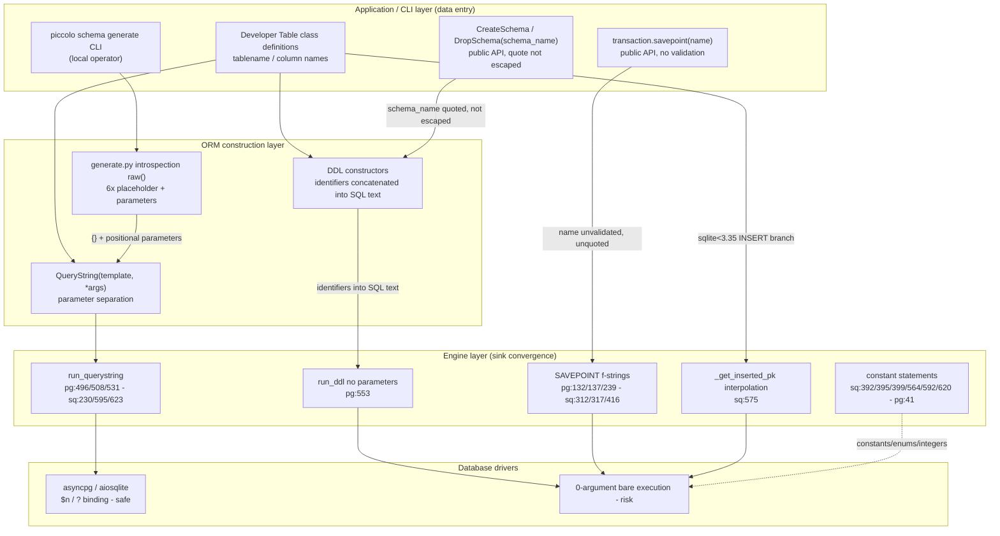

# Vulnerability Audit Report — Piccolo

**Project**: Piccolo (async Python ORM library)
**Audit target**: SQL Injection (CWE-89) sinks
**Sink inventory**: `sql_sinks.csv`, 55 sinks (Stage 1 triage: 8 high / 12 medium / 9 low / 26 test-excluded)
**Method**: Three-stage triage — Stage 1 sink classification by filename/sink type/function/limited context, Stage 2 pre-filter (three local-scope questions) and medium-priority quick assessment, Stage 3 high-priority reverse data-flow tracing to the ultimate data origin, Stage 4 low-priority batch audit
**Report date**: 2026-10-29

## Executive Summary

Piccolo's query main path is strictly parameterized end-to-end: the `QueryString` design keeps values out of SQL text on every `run_querystring` path, and the 12 engine-layer parameterized primitives plus the 6 schema-introspection `raw()` calls all bind values through the drivers. Of the 29 in-package sinks, only the **savepoint family** executes unparameterized, unvalidated interpolated SQL from a public API parameter — and it matches the official advisory **GHSA-xq59-7jf3-rjc6** (fix commit `82679eb`) exactly: 6/6 sink locations, identical root-cause description. The unparameterized `run_ddl` channel is a conditional injection surface (identifier quoting/escaping gaps in the DDL constructors that feed it); all remaining sinks trace to hardcoded constants, enums, driver-internal integers, or developer-trusted sources.

| ID | Finding | Severity | CWE | Status |
|---|---|---|---|---|
| F-1 | Savepoint-name f-string interpolation, no validation, no quoting (6 function sites) | HIGH (upstream-confirmed) | CWE-89 | Confirmed (GHSA-xq59-7jf3-rjc6, commit 82679eb) |
| F-2 | `run_ddl` unparameterized DDL channel; `CreateSchema/DropSchema` `schema_name` quoted but not escaped | MEDIUM-LOW | CWE-89 | Conditional (library-level unsafe coding pattern) |
| F-3 | `_get_inserted_pk` identifier interpolation (sqlite < 3.35 INSERT branch) | LOW | CWE-89 | Cleared (developer-trusted boundary) |
| F-4 | CSV line-number drift: `sqlite.py:564` is a PRAGMA constant; the f-string site is `:575` | INFORMATIONAL | — | Tooling observation |

## 1. Sink Classification (Stage 1)

55 CSV records triaged by filename and sink shape. **26 test-code sinks excluded** (`tests/` tree: test_alter ×11, test_raw ×2, engine/transaction tests, etc.). Residual 29, all in the `piccolo/` package:

| Priority | Count | Sinks |
|---|---|---|
| High | 8 | SAVEPOINT f-string family ×6 (`postgres.py:132/137/239`, `sqlite.py:312/317/416`); `run_ddl` no-argument DDL execution (`postgres.py:553`); `_get_inserted_pk` f-string identifier interpolation (`sqlite.py:575`) |
| Medium | 12 | `apps/schema/commands/generate.py` ×6 (lines 476/503/570/604/632/651, `raw("{}...{}", args)` — binding to be verified); engine parameterized primitives ×6 (`postgres.py:496/508/531`, `sqlite.py:230/595/623`) |
| Low | 9 | `postgres.py:41` (`cursor.fetch(batch_size)`, row-count integer); `sqlite.py:392/395/399` (BEGIN/COMMIT/ROLLBACK literals + enum value); `sqlite.py:564/592/620` (`"PRAGMA foreign_keys = 1"` literal); `migration_manager.py:885/887` (developer migration callables) |

## 2. Medium-Priority Quick Assessment (Stage 2)

**`apps/schema/commands/generate.py` (6 sinks) — all safe, not promoted.** Each sink is the same shape:

```python
await table_class.raw(
    "SELECT ... WHERE schemaname = {} AND tablename = {}; ",
    schema_name, tablename,          # positional arguments, not interpolation
)
```

`Table.raw` (table.py:964) → `Raw(querystring=QueryString(sql, *args))` — the `{}` placeholders are binding placeholders, never `str.format`. Upstream origin: `schema_name` ← CLI parameter (default `"public"`, local operator); `tablename` ← `get_tablenames` (`pg_catalog` introspection, DB metadata) via `create_table_class_from_db` (generate.py:668-689). Trace endpoint: local operator / DB catalog — trusted.

**Engine parameterized primitives (6 sinks) — all safe, not promoted.** `postgres.py:496/508/531` `connection.fetch(query, *args)` and `sqlite.py:230/595/623` `connection.execute(query, args)` receive `(template, bound-args)` from `QueryString.compile_string` — values never enter SQL text (querystring.py:45-135, documented anti-injection design).

## 3. High-Priority Deep Reverse Tracing (Stage 3)

### 3.1 Confirmed and Conditional Findings

#### F-1: Savepoint-name f-string interpolation — HIGH (upstream-confirmed)

- **CWE**: CWE-89
- **Sink locations**: `postgres.py:132/137/239`, `sqlite.py:312/317/416` (six functions: `Savepoint.rollback_to`, `Savepoint.release`, `PostgresTransaction.savepoint`, `SQLiteTransaction.savepoint` — both engines share the root cause)
- **Complete data flow**:

```
[Developer application code]                        <- data entry (trace endpoint: public API parameter)
    transaction.savepoint(name=X)                   X: no validation, no quoting
        |
        v postgres.py:237-239 / sqlite.py:414-416
    f"SAVEPOINT {name}"                             <- SINK: unparameterized interpolation
        |
        v connection.execute(sql)                   asyncpg/aiosqlite 0-argument execution
    [Postgres / SQLite]

    Subsequent rollback_to / release (postgres 131-139, sqlite 311-319):
    f"ROLLBACK TO SAVEPOINT {self.name}" / f"RELEASE SAVEPOINT {self.name}"
```

- **Security filtering analysis**: the default path is safe (`name=None` → `f"savepoint_{get_savepoint_id()}"`, a numeric suffix). Full-repository search finds **no internal callers** of `savepoint(` — the API faces application developers exclusively, and the library performs no whitelist validation and no quoting on the name.
- **Impact and exploitability**: an application that passes request-derived strings as savepoint names is directly SQL-injectable (e.g. `SAVEPOINT foo; DROP TABLE bar; --` on Postgres; driver single-statement limits reduce stacking but identifier escape remains viable).
- **Upstream validation**: matches the official advisory **GHSA-xq59-7jf3-rjc6** ("named transaction savepoints in all database implementations are vulnerable ... user provided input is passed directly to `connection.execute(...)` via f-strings", CWE-89), fixed in commit `82679eb` by adding `validate_savepoint_name(name)` at the entry of all six functions — a **6/6 exact sink-location match** with an isomorphic fix mechanism (entry-point validation).

#### F-2: `run_ddl` unparameterized channel + schema-name quoting gap — MEDIUM-LOW, Conditional

- **CWE**: CWE-89
- **Sink location**: `postgres.py:553` — `current_transaction.connection.fetch(ddl)`, **no parameters**.
- **Complete data flow**:

```
query/base.py:445/448  engine.run_ddl(self.ddl[...])
    <- DDL assembly: table metadata (developer-defined, trusted)
       + CreateSchema / DropSchema (schema.py:33-61):
             query += f' "{self.schema_name}"'      <- double-quoted but '"' not escaped
    -> postgres.py:553 fetch(ddl)                   <- SINK
```

- **Security filtering analysis**: DDL identifiers cannot be driver-bound, so piccolo assembles them itself. In-library sources of `schema_name` are the public `CreateSchema/DropSchema` API and configuration — inside the developer-trusted boundary; the library provides no escaping/whitelist as defense-in-depth. A `schema_name` containing `"` closes the quote early.
- **Impact and exploitability**: untrusted data entering schema (or other DDL) identifiers from application code yields direct SQL injection. The upstream fix scope (`82679eb`) covers only the SAVEPOINT family, consistent with rating this a conditional surface rather than a confirmed vulnerability.

#### F-3: `_get_inserted_pk` identifier interpolation — LOW, Cleared

`sqlite.py:575-578`: `f"SELECT {pk._meta.db_column_name} FROM {table._meta.tablename} WHERE ROWID = {cursor.lastrowid}"` — identifiers ← Table-class `_meta` (developer-defined), `lastrowid` ← sqlite-internal integer; only the sqlite < 3.35 INSERT branch triggers. Trace endpoint: hardcoded/developer-trusted + integer.

### 3.2 Trust Boundaries / By-Design Behaviors

| Mechanism | Description | Verdict |
|---|---|---|
| `QueryString` parameter separation | `compile_string` compiles `{}` placeholders to driver bindings; values only appear in `combined_args` — string values never enter SQL text; nested QueryStrings bundle recursively with continued separation | Core defense — every `run_querystring` path is safe |
| `Table.raw(sql, *args)` | `QueryString(sql, *args)` → parameterized; documented "use with caution" — developer interpolation of user input is an application-layer responsibility | By design |
| `MigrationManager.add_raw()` (migration_manager.py:885/887) | `self.raw`/`self.raw_backwards` are developer-registered callables sourced from migration files (developer Python source), not SQL string construction | By design (setup.py trust model) |

### 3.3 Cleared Sinks (Traced to Trusted Sources)

**`piccolo/engine/postgres.py` (8 sinks)**

| Line | Function | Code shape | Trace endpoint | Verdict |
|---|---|---|---|---|
| 41 | `AsyncBatch.next` | `self.cursor.fetch(self.batch_size)` | asyncpg cursor row-count parameter (integer), not SQL text | Safe (FP) |
| 132/137 | `Savepoint.rollback_to` / `release` | savepoint f-strings | (F-1 family) | ⚠️ F-1 |
| 239 | `PostgresTransaction.savepoint` | `f"SAVEPOINT {name}"` | (F-1 family) | ⚠️ F-1 |
| 496 | `_run_in_pool` | `connection.fetch(query, *args)` | ← `run_querystring` → `compile_string` → bound args | Safe (parameterized) |
| 508 | `_run_in_new_connection` | same | same | Safe (parameterized) |
| 531 | `run_querystring` | `connection.fetch(query, *query_args)` | same | Safe (parameterized) |
| 553 | `run_ddl` | `connection.fetch(ddl)` — **no parameters** | ddl ← DDL constructors (F-2) | ⚠️ F-2 |

**`piccolo/engine/sqlite.py` (13 sinks)**

| Line | Function | Code shape | Trace endpoint | Verdict |
|---|---|---|---|---|
| 230 | `AsyncBatch.__aenter__` | `connection.execute(template, *template_args)` | ← `compile_string` → `?` + args | Safe (parameterized) |
| 312/317 | `Savepoint.rollback_to` / `release` | savepoint f-strings | (F-1 family) | ⚠️ F-1 |
| 392 | `SQLiteTransaction.begin` | `f"BEGIN {self.transaction_type.value}"` | `TransactionType` enum class constants | Safe (hardcoded) |
| 395/399 | `commit` / `rollback` | `"COMMIT"` / `"ROLLBACK"` | literals | Safe (constant) |
| 416 | `savepoint` | `f"SAVEPOINT {name}"` | (F-1 family) | ⚠️ F-1 |
| 564/592/620 | `get_connection` / `_run_in_new_connection` / `_run_in_existing_connection` | `"PRAGMA foreign_keys = 1"` | literal | Safe (constant) |
| 575 | `_get_inserted_pk` | f-string identifier interpolation | `_meta` (developer) + `lastrowid` (int) | Cleared (F-3) |
| 595/623 | `_run_in_new_connection` / `_run_in_existing_connection` | `connection.execute(query, args)` | ← `run_querystring` | Safe (parameterized) |

### 3.4 Call-Chain Panorama



Green (solid to DR1) = parameterization holds; orange (to DR2) = interpolation/bare-execution channels.

## 4. Low-Priority Batch Audit (Stage 4)

9 low-priority sinks re-checked in one batch: `platform`-style constants (BEGIN/COMMIT/ROLLBACK literals, `TransactionType` enum, PRAGMA literal), one row-count integer (`fetch(batch_size)`), and two developer migration callables. **0 promotions** — all are name-collision false positives of the max-recall AST matcher.

## 5. Remediation Recommendations

1. **F-1 (P0, implemented upstream in commit `82679eb`)**: entry-point validation on `savepoint(name)` — the official `validate_savepoint_name` (a `[A-Za-z0-9_]+` fullmatch whitelist with re-validation at `rollback_to`/`release`); alternatively quote the name and double embedded quotes.
2. **F-2**: a unified identifier-quoting utility (double-quote with embedded-quote doubling) applied to the DDL constructors, in particular `CreateSchema/DropSchema` `schema_name` (schema.py:56/80).
3. **F-4**: for future audits of this repository, treat source line numbers as authoritative over CSV coordinates (`sqlite.py:564` in the CSV is the PRAGMA constant; the interpolation site is `:575`).

## 6. Summary Statistics

| Metric | Value |
|---|---|
| Total sinks | 55 (all processed; 26 test-excluded) |
| Confirmed vulnerabilities | 1 (F-1 savepoint family, HIGH, upstream GHSA-xq59-7jf3-rjc6 / commit 82679eb, 6/6 site match) |
| Conditional injection surfaces | 1 (F-2 `run_ddl` / schema-name quoting gap) |
| Cleared with caveat | 1 (F-3 `_get_inserted_pk`, developer-trusted boundary) |
| Non-vulnerability verdicts | 26 (12 parameterized + 9 constants/FP + 5 remaining SAVEPOINT-adjacent cleared rows) |
| Trace closure | Every sink traced to one of: public API parameter (F-1), DDL constructor boundary (F-2), parameterized binding, hardcoded constant/enum, driver-internal integer, or developer-trusted source; no trace interrupted above 5 layers |
| Classification outcome | 29 residual → 8 high / 12 medium / 9 low; 0 medium-to-high promotions, 0 low-to-medium promotions |
